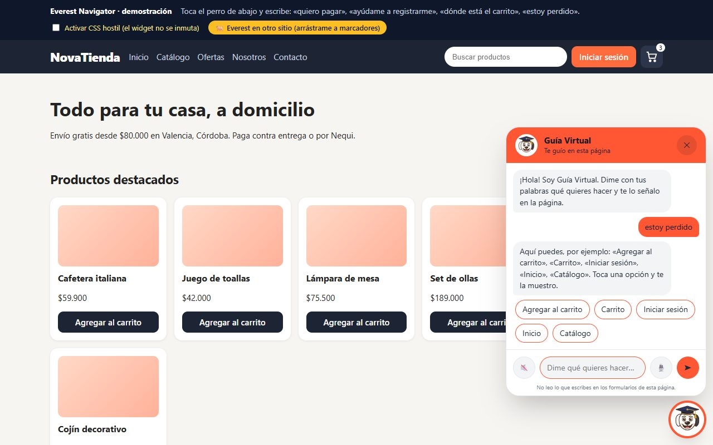
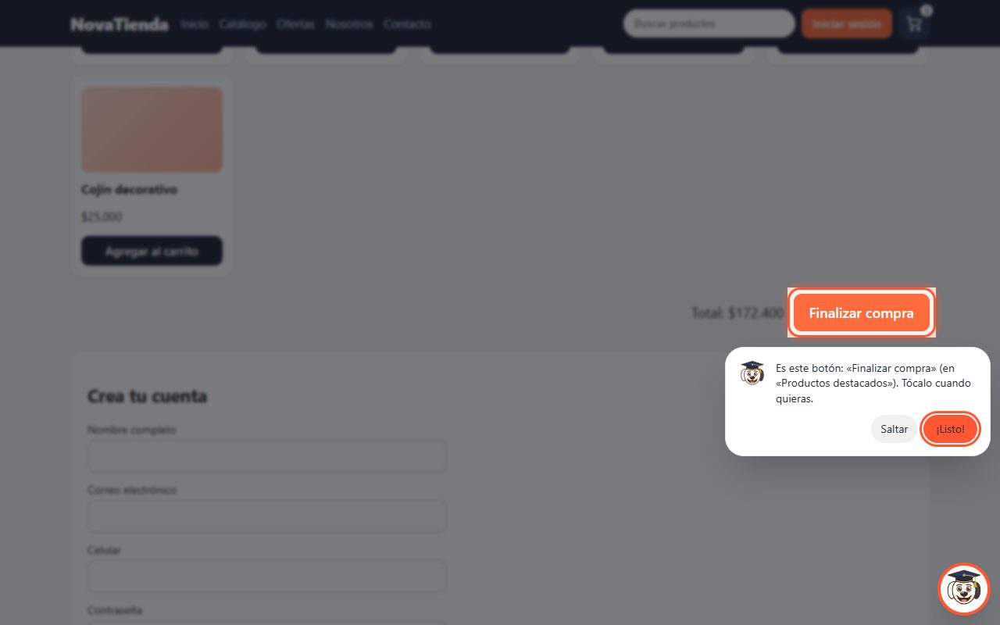
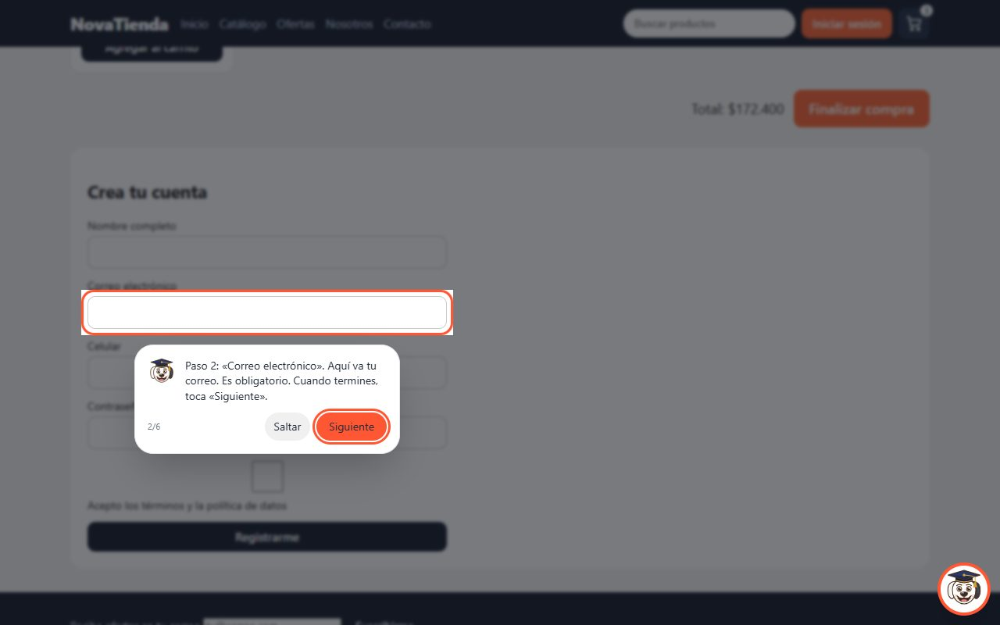
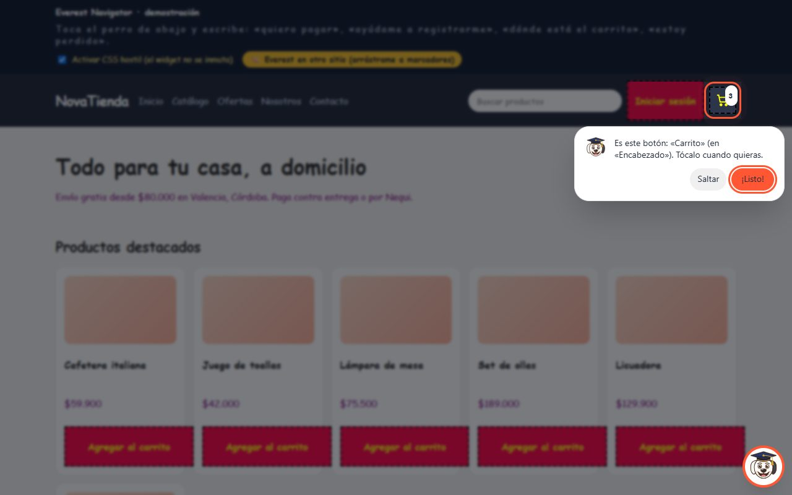
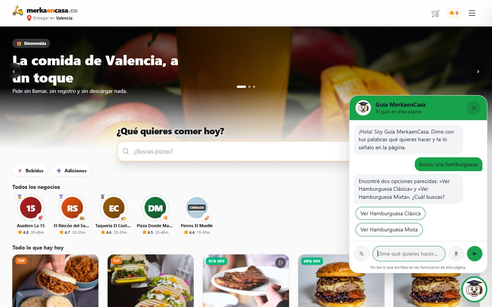
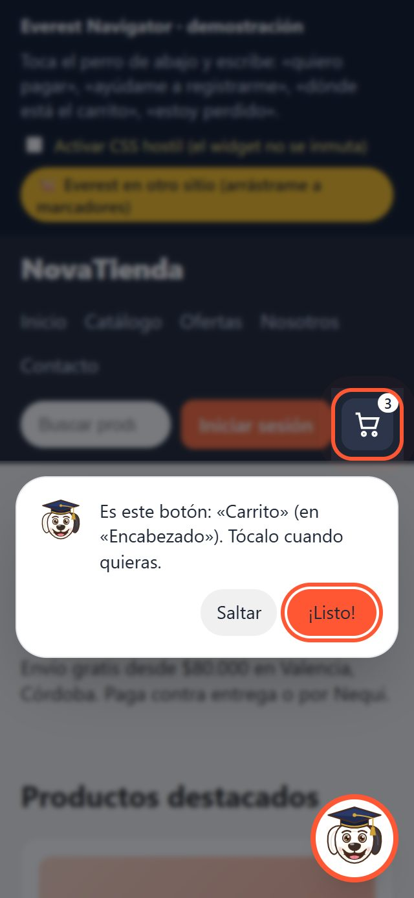

<p align="center">
  
</p>

<h1 align="center">Everest Navigator</h1>
<p align="center"><b>Un guía que acompaña a cada visitante de tu sitio web hasta lo que vino a hacer</b><br>
Producto SaaS de marca blanca de <a href="https://github.com/macsaenz07">MyS SinergiaaS</a> · demostración abierta</p>

<p align="center">
  <a href="https://everest-navigator.vercel.app"></a>
  
  
</p>

---

## El problema

Cada visitante que no encuentra el botón de pagar, el formulario de registro o el WhatsApp del
negocio es una venta que se va. Las plataformas de «adopción digital» que resuelven esto cuestan
miles de dólares al año, están pensadas en inglés y obligan a dibujar a mano cada recorrido, que
se rompe con el siguiente rediseño de la página.

## Lo que entregamos

Un asistente que se instala en **cualquier sitio web con una sola línea** y que entiende lo que
el visitante pide con sus propias palabras.

| Resultado | Qué significa para el negocio |
|---|---|
| **Sin recorridos que dibujar** | Everest lee la página por su cuenta y sabe qué se puede hacer en ella. Si el sitio cambia, se adapta solo. |
| **Habla como la gente** | «Dónde pago», «quiero ver mi carito», «estoy perdido»: entiende sinónimos, errores de digitación y español coloquial. |
| **Señala, no explica** | Oscurece la pantalla y resalta el botón exacto. El visitante lo toca ahí mismo. |
| **Formularios acompañados** | «Ayúdame a registrarme» abre una guía campo por campo hasta el botón final. |
| **Demanda insatisfecha** | Lo que la gente busca y tu página no ofrece queda contado en un reporte. Es información de venta. |
| **Tu marca, no la nuestra** | Color, nombre del asistente, avatar, posición, tema claro u oscuro y voz se configuran al instalar. |

## Experiencia de usuario

- **Cero fricción:** un botón flotante, una caja de texto y, si se quiere, dictado por voz y lectura en voz alta.
- **Nunca un callejón sin salida:** si algo no existe en la página lo dice con honestidad y ofrece las opciones más cercanas.
- **Privacidad por diseño:** jamás lee lo que el visitante escribe en los formularios y no envía datos a ningún servidor.
- **No rompe tu sitio:** se ve igual sobre cualquier diseño y tu página tampoco cambia. Pruébalo en la demo con el interruptor «CSS hostil».
- **Accesible:** se usa con teclado, respeta la preferencia de movimiento reducido y elige solo el contraste correcto para el color de tu marca.
- **Funciona en celular** desde 320 px de ancho.

## Capturas

| Le pides lo que quieres | Te lo señala | Te acompaña en el formulario |
|---|---|---|
|  |  |  |

| Página con estilos agresivos: el guía no se inmuta | En un sitio real ya existente |
|---|---|
|  |  |

<p align="center"></p>

## Instalación

```html
<script src="https://everest-navigator.vercel.app/everest-widget.js"
        data-color="#FF5733" data-name="Guía Virtual" data-voice="false"></script>
```

O con control total desde JavaScript: `Everest.init({ primaryColor, assistantName, voiceEnabled, ... })`.

## Stack tecnológico aplicado

| Capa | Tecnología |
|---|---|
| Widget | JavaScript estándar sin dependencias · un solo archivo de 50 KB |
| Diseño | Tailwind CSS · Web Components con aislamiento total de estilos |
| Voz | Dictado y lectura en voz alta nativos del navegador (es-CO) |
| Inteligencia | Comprensión de intención en español incluida, sin costo por consulta · conexión opcional a un modelo de IA propio del cliente |
| Calidad | Pruebas automáticas en navegador real sobre página hostil y sitio en producción |
| Publicación | Vercel |

---

## Sobre este repositorio

> **Repositorio de exhibición.** Contiene la **tienda de prueba** donde se instala el guía y la
> **hoja de diseño** del widget, para que otros desarrolladores puedan valorar la calidad de
> nuestro trabajo.
>
> **No incluye** el motor de comprensión de intención, el lector de páginas, el motor de
> resaltado ni las pruebas. Ese material es propiedad de MyS SinergiaaS y no se publica.

```
frontend/
├── tienda-de-prueba.html     Tienda ficticia con el guía instalado en una línea (incluye el CSS hostil)
└── sistema-de-diseno.css     Hoja de diseño del widget sobre Tailwind CSS
```

## ¿Quiere un guía así en su sitio?

Lo instalamos con su marca en tiendas virtuales, plataformas de servicios y sistemas de gestión.

**MyS SinergiaaS** · *Automatiza. Escala. Vende.*
🌐 [Portafolio completo](https://mac-saenz-portafolio.vercel.app) · 💬 WhatsApp +57 314 878 8974

© MyS SinergiaaS. Todos los derechos reservados. El código publicado aquí es material de
demostración y no se licencia para su reutilización.
